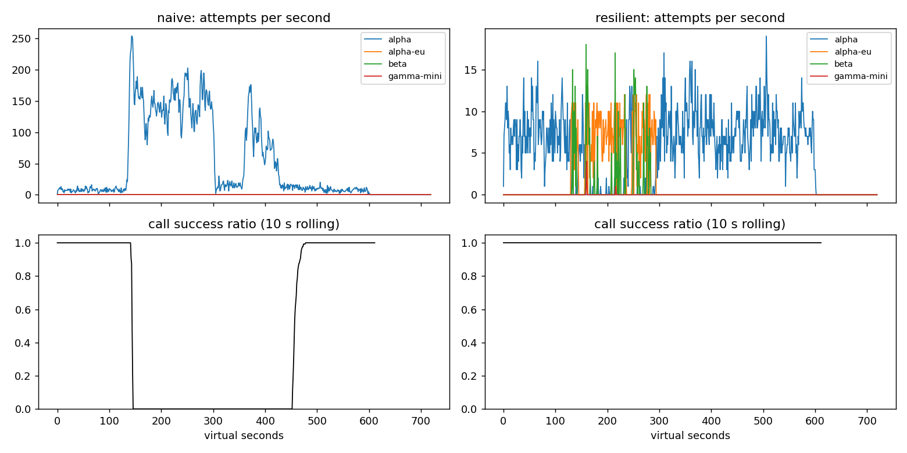

# Lab 25B — Reliability Game Day: Report & Postmortem

**Họ tên:** Nguyễn Lê Phước Tiến  
**Mã học viên:** 2A202602616  
**Commit:** `670c048c835b19c090fdd6fc731ddb43e2eb37aa`  
**Điểm tự động đã xác nhận trên bộ public:** 84/88 (4 điểm SLO hidden chưa thể chấm cục bộ).

## 1. Kết quả Game Day

|Tape|Client|Availability|P95 (s)|Amplification|Retry ratio|Cost/turn|Recovery (s)|PASS|
|---|---|---:|---:|---:|---:|---:|---:|---|
|G1_rate_limit_spike|naive|0.7194|7.157|7.738|6.738|2.163|4.0|FAIL|
|G1_rate_limit_spike|resilient|1.0|4.776|1.062|0.002|2.101|0.0|PASS|
|G2_overload_storm|naive|0.456|15.034|9.904|8.904|4.627|155.0|FAIL|
|G2_overload_storm|resilient|1.0|10.92|1.041|0.007|2.119|0.0|PASS|
|G3_brownout|naive|1.0|4.768|1.164|0.164|2.328|0.0|FAIL|
|G3_brownout|resilient|1.0|4.66|1.06|0.034|2.145|0.0|PASS|
|G4_slow_region|naive|1.0|13.764|1.004|0.004|2.008|0.0|FAIL|
|G4_slow_region|resilient|1.0|5.562|1.015|0.002|2.072|0.0|PASS|
|G5_bad_deploy_then_quota|naive|0.3699|5.359|17.03|16.03|2.124|—|FAIL|
|G5_bad_deploy_then_quota|resilient|0.8179|5.477|1.003|0.002|2.504|—|PASS|
|G6_provider_outage|naive|0.517|4.836|12.344|11.344|2.009|0.0|FAIL|
|G6_provider_outage|resilient|1.0|5.961|1.055|0.019|2.189|0.0|PASS|

## 2. Cấu hình và cơ sở lựa chọn

|Tham số|Giá trị|Cơ sở định lượng|
|---|---:|---|
|`attempt_timeout_s`|8.0|G4: P95 từ 13.764s (naive) xuống 5.562s; giới hạn thời gian để failover trước deadline.|
|`max_attempts_per_provider`|2|G2: amplification 9.904 → 1.041, chỉ tối đa một retry/provider.|
|`min_time_left_s`|1.0|Không mở attempt không còn đủ thời gian hữu ích; với timeout 30s ở G6 đã có 109 lượt `deadline`, còn cấu hình chuẩn không có GiveUp.|
|`backoff_base_s`|0.25|Full jitter giúp phân tán các lần retry, G2 retry ratio 0.007.|
|`backoff_cap_s`|4.0|Giới hạn backoff trong deadline 30s; cấu hình chuẩn giữ G2 recovery ở 0s.|
|`retry_budget_ratio`|0.1|G3: retry ratio 0.164 → 0.034; chặn retry storm.|
|`retry_budget_min_per_s` / `max_tokens`|0.5 / 20|Cho phép phục hồi retry sau lúc yên nhưng chặn burst; khi tắt giới hạn hiệu dụng, G2 amplification tăng 1.380 → 1.675.|
|`quota_cooldown_s`|300|Không tiếp tục gửi vào account đã hết quota; G5 giữ `unneeded_failovers` trong ngưỡng và availability 81.79%.|
|`breaker.window_size`|20|20 kết quả gần nhất để phản ứng với suy giảm.|
|`breaker.min_calls`|10|10 mẫu trước khi mở, tránh nhiễu mẫu nhỏ.|
|`breaker.failure_rate_threshold`|0.5|50% lỗi đủ để isolate provider xấu.|
|`breaker.slow_call_s`|5.0|G4 P95 giảm còn 5.562s khi phát hiện slow calls.|
|`breaker.slow_rate_threshold`|0.6|Chỉ mở khi suy giảm chậm chiếm đa số, nhờ đó G4 giảm P95 mà vẫn đạt availability 100%.|
|`breaker.open_duration_s`|10.0|Cho provider thời gian phục hồi, half-open probe có kiểm soát.|
|`breaker.half_open_max_probes`|2|2 probe, không đổ toàn bộ traffic vào provider vừa hồi.|
|`breaker.half_open_successes`|2|Cần hai probe tốt trước khi đóng breaker; G2 quay lại primary với `primary_share_after_restore = 1.0`.|

**Bảng quyết định on_error:** 400/401/422 → release permit, GiveUp (không retry/failover). 429 rate-limit → release permit, cooldown theo Retry-After, failover. 429 quota → release permit, cooldown dài, failover. Timeout/5xx/overload → ghi breaker, retry có jitter nếu còn ngân sách và deadline; nếu không, failover.

## 3. Ba thí nghiệm reliability

### 3.1 Retry budget khi breaker bị cấu hình sai

|Tape|Budget|Availability|Amplification|Retry ratio|Recovery (s)|
|---|---|---:|---:|---:|---:|
|G2_overload_storm|ON|0.9987|1.38|0.058|0.0|
|G2_overload_storm|OFF|0.9666|1.675|0.495|25.0|
|G3_brownout|ON|1.0|1.136|0.068|0.0|
|G3_brownout|OFF|1.0|1.162|0.159|0.0|

Breaker min_calls = 1,000,000,000 và max_attempts_per_provider = 5. Trên G2, budget ON giữ amplification 1.380, OFF lên 1.675 và recovery tăng 0 → 25s. Trên G3, retry ratio tăng 0.068 → 0.159 khi tắt budget. Breaker bảo vệ sức khỏe từng provider; budget là chốt chặn tổng lượng retry ngay cả khi breaker lỗi cấu hình.

### 3.2 Timeout 8s so với 30s

|Tape|Timeout|Availability|P95|GiveUp reasons|
|---|---:|---:|---:|---|
|G6_provider_outage|8|1.0|5.961|{}|
|G6_provider_outage|30|0.9488|5.315|{'deadline': 109, 'no_provider_available': 13}|
|G4_slow_region|8|1.0|5.562|{}|
|G4_slow_region|30|1.0|5.608|{}|

G6: timeout 30s giảm availability so với 8s vì request mắc kẹt lâu, không còn đủ deadline để failover. P95 chỉ tính các lượt thành công nên không phản ánh đầy đủ lượt thất bại (survivorship bias). G4 phần lớn request vẫn trả lời, vì thế tác động nhỏ hơn. Timeout cần dựa vào p99 bình thường, deadline end-to-end và thời gian dự phòng cho fallback.

### 3.3 Tương thích tool calling

|G6|Availability|Incompatible routes|GiveUp `incompatible_model_output`|PASS|
|---|---:|---:|---:|---|
|Có lọc `supports_tools`|1.0000|0|0|PASS|
|Bỏ lọc `supports_tools`|0.9019|234|234|FAIL|

`gamma-mini` chỉ hỗ trợ chat. Khi bỏ lọc, 234 yêu cầu thao tác như hoàn tiền bị chuyển tới model không có tool calling và đều tạo output không tương thích; availability giảm từ 100% xuống 90.19%. Với product manager, đây là 234 lượt khách không thể hoàn tất tác vụ dù hệ thống vẫn có model đang online — một lỗi chức năng, không chỉ là tăng latency.

## 4. Workflow hoàn tiền

|Executor|Completion|Crashes|Duplicate refunds|Duplicate emails|Lost refunds|Overpaid cents|Wasted LLM/crash|
|---|---:|---:|---:|---:|---:|---:|---:|
|naive|1.0|81|128|81|0|1496700|1.123|
|yours|1.0|66|0|0|0|0|0.303|

Idempotency key bảo vệ side effect khi request đã thực thi nhưng response mất; checkpoint tránh lặp lại các bước đã thành công sau khi worker khởi động lại. Chỉ key thì LLM/lookup vẫn chạy lại tốn phí; chỉ checkpoint thì crash giữa payment và lưu checkpoint vẫn có thể thanh toán hai lần. Ghi checkpoint trước payment nguy hiểm vì crash sau checkpoint sẽ bỏ qua thanh toán thật (lost refund). `WorkerCrash` không bị nuốt; retry dùng cùng key.

## 5. Alerting và error budget

|Sự cố|Mong đợi|Naive|Burn-rate|Delay (min)|
|---|---|---|---|---:|
|checkout_bug|page|detected|detected|27|
|provider_outage|page|detected|detected|4|
|deploy_blip|none|page|none|—|
|slow_leak|ticket|missed|detected|1337|
|degraded_evening|page|detected|detected|291|
|night_spike|none|page|none|—|
|small_bump|none|page|none|—|

30-day budget: 25,901,755 requests, 55,618 bad, allowed 129,508.8; consumed **42.95%**, remaining **57.05%**. Freeze releases: **False**.

Một đợt small_bump ngắn không nên đánh thức on-call vì cần cả cửa sổ dài và ngắn cùng vượt burn-rate; theo public data không có false page.

## 6. Blameless postmortem — G2 overload storm

**Tóm tắt:** Provider alpha mất 75% GPU capacity tại t=120s. Client naive retry nhiều tầng làm tăng tải, hàng đợi tiếp tục tắc dù alpha phục hồi t=300s. Kết quả availability chỉ 45.6%, amplification 9.904 và recovery mất 155s.

**Ảnh hưởng:** 1285/2362 lượt turn thất bại (54.40%), từ lúc mất GPU ở t=120 đến khi hệ thống hồi phục ở t=455, tổng cộng khoảng 335s (5 phút 35 giây); riêng sau khi provider hồi phục vẫn mất thêm 155s. Nếu coi 2362 lượt này là toàn bộ traffic tháng và SLO là 99.5%, ngân sách chỉ cho phép 11.81 lượt lỗi; 1285 lỗi tiêu thụ **10,880.61%** ngân sách tháng, tức vượt ngân sách **10,780.61 điểm phần trăm**. P95 của các lượt thành công là 15.034s.

**Timeline (số từ CSV):**

|t (s)|Attempts/s tổng|Calls completed|Calls OK|10s rolling success ratio|
|---:|---:|---:|---:|---:|
|110|5|9|9|1.000|
|120|5|7|7|1.000|
|150|163|3|0|0.000|
|240|105|2|0|0.000|
|300|115|5|0|0.000|
|330|6|1|0|0.000|
|400|51|5|0|0.000|
|455|13|5|4|0.300|
|480|8|11|11|1.000|

**Trigger:** GPU capacity của alpha giảm tại t=120s. **Root cause:** Retry không giới hạn theo ba tầng, thiếu jitter/budget/breaker, khiến lượng physical attempts tăng cao hơn logical calls. Tại t=300s, GPU đã trở lại nhưng backlog gồm cả request user đã bỏ vẫn chiếm worker/queue; retry duy trì offered load cao hơn khả năng xử lý → metastable failure. Đây là lỗi thiết kế hệ thống, không quy trách nhiệm cá nhân.

**Điều giúp:** cooldown, failover, breaker half-open và token-bucket budget. **Điều làm tệ:** retry dồn dập, chờ quá deadline, thiếu cơ chế load shedding.

|Action item|Loại|Owner|Kiểm chứng|
|---|---|---|---|
|Giới hạn retry bằng token bucket|prevent|Gateway engineer|G2 amplification ≤ 1.2 trong CI|
|Theo dõi retry amplification và queue backlog|detect|SRE|Alert khi amplification > 1.5 kéo dài 5 phút|
|Circuit breaker + half-open tối đa 2 probes|mitigate|Platform engineer|G2 recovery ≤ 30s, 0 thundering herd|
|Timeout theo deadline và fallback tương thích|mitigate|Agent engineer|G6 availability ≥ 95%, incompatible_routes = 0|

## 7. Điểm yếu còn lại

G2 ResilientClient có P95 = 10.920s (cao hơn G1 4.776s), vì retry/failover vẫn phải trả thêm độ trễ khi primary quá tải. Hướng cải thiện: adaptive timeout theo latency p99 và concurrency limits per provider; xác nhận lại trên nhiều seed và theo dõi chi phí, không tối ưu chỉ một tape.

## 8. Semantic Cache

|Client|Availability|FAQ availability|Hit ratio|Stale served|Wrong|Outdated|Cost/turn|PASS|
|---|---:|---:|---:|---:|---:|---:|---:|---|
|resilient|0.8373|0.8424|0.0|0|0|0|1.386|FAIL|
|cached|0.912|0.9645|0.635|174|0|6|0.927|PASS|

**Cấu hình:** similarity_threshold = 0.92 để tránh near-miss; ttl_s = 45 để giới hạn thời gian câu trả lời có thể cũ; max_stale_s = 600 để duy trì FAQ khi provider sập; max_entries = 500 để chặn tăng RAM vô hạn. Với cấu hình này C1: wrong=0, outdated=6, FAQ availability=96.45%, cache hit=63.5%.

**Thí nghiệm threshold:**

|Threshold|Hit ratio|Wrong answers|Outdated|Cost/turn|
|---:|---:|---:|---:|---:|
|0.8|0.652|227|8|1.005|
|0.92|0.635|0|6|0.927|
|0.97|0.558|0|2|0.98|

Threshold 0.80 trộn các intent gần nhau nhưng khác nghĩa (`other_question`: near-miss như chính sách hoàn tiền vs thời gian hoàn tiền), gây wrong answers. Threshold 0.97 an toàn nhưng ít hit hơn.

**Thí nghiệm TTL:**

|TTL (s)|Hit ratio|Outdated answers|FAQ availability|
|---:|---:|---:|---:|
|30|0.592|2|0.9645|
|60|0.652|3|0.9645|
|300|0.731|95|0.964|

Webhook invalidation chỉ tác động khi nguồn tài liệu phát sự kiện cập nhật; nếu thay đổi chưa có webhook, TTL vẫn là giới hạn độ cũ của cache fresh.

**Stale-if-error:** max_stale_s = 0 làm FAQ availability = 0.8634 thay vì 0.9645 khi bật 600s; stale_served từ 0 lên 174.

**An toàn dữ liệu cá nhân:** Không cache trạng thái đơn/refund/điểm kể cả cache theo user vì quyền truy cập, dữ liệu biến động liên tục và nguy cơ leak khi khóa user/session bị dùng sai; luôn hỏi nguồn có xác thực. **Alert khi cache che outage:** monitor provider error rate, fallback rate, breaker OPEN, stale_served, cache_hit_ratio và origin availability riêng; dashboard user availability xanh không được che lỗi upstream.

## 9. Kiểm thử và giới hạn kết quả

- Unit tests: 82/82 PASS.
- Game Day public: 6/6 PASS. Workflow public: PASS. SLO public: PASS. Cache public: PASS.
- Kiểm tra độ ổn định bổ sung: cả 6 Game Day tapes và C1 đều PASS với ba seed 7, 25 và 101.
- Automatic score local: **84/88**. 4 điểm SLO hidden chỉ được xác nhận bởi grader của giảng viên; không khẳng định 88/88.
- Số liệu và kết luận được lấy từ mô phỏng seed 25, không đại diện production traffic.
